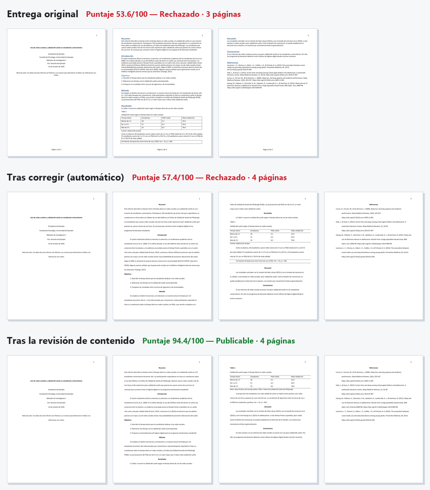
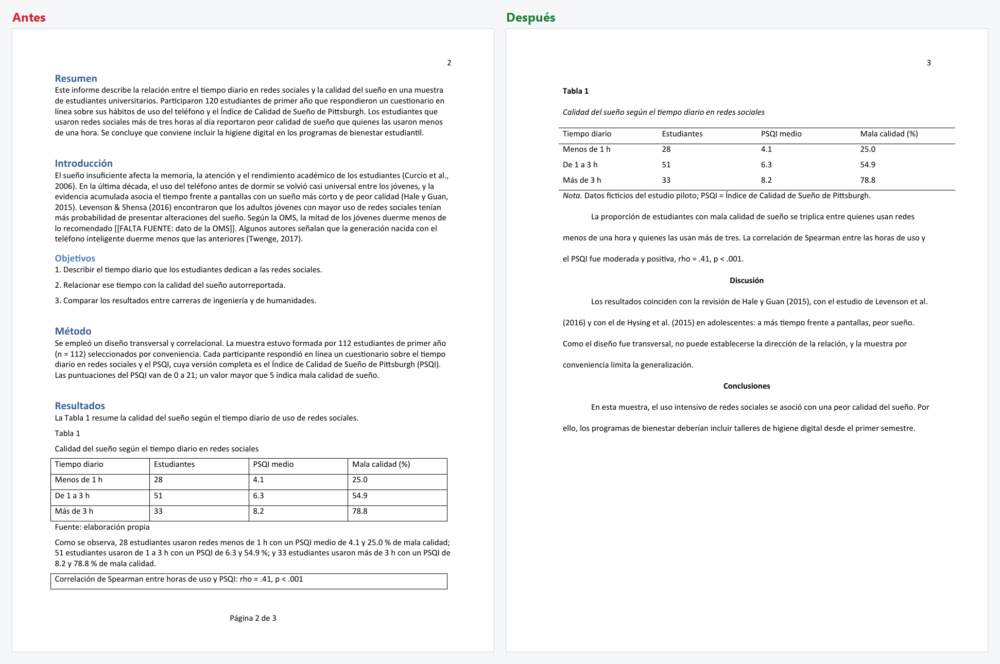
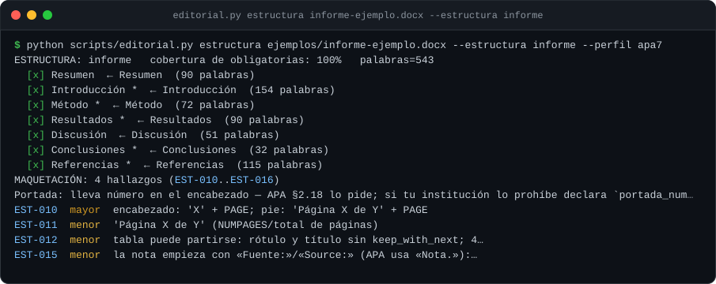

# editorial-academica

**Una skill para tu agente de IA que revisa tesis, informes y artículos como lo haría un comité editorial: formato APA 7 o IEEE, citas, fuentes que existen de verdad y un documento que se sostiene de principio a fin.**

[](https://github.com/Xavier82h8/editorial-academica/actions/workflows/pruebas.yml)
[](LICENSE)
[](requirements.txt)
[](CHANGELOG.md)
[](docs/REGLAS.md)
[](#instalación)

> Tu asesor no debería gastar la revisión en márgenes, sangrías y comas de la lista de referencias. Que lo haga la máquina, con la regla citada, y que la conversación con tu asesor sea sobre tus ideas.



<sub>Páginas renderizadas con LibreOffice a partir de los .docx de [`ejemplos/`](ejemplos/README.md). Los datos del informe son ficticios; las cuatro referencias son reales y se verificaron contra Crossref.</sub>

## Qué es una skill (y por qué esto no es una app)

Una *skill* es un paquete de instrucciones y herramientas que un agente de IA de terminal (Claude Code, Codex, Gemini CLI, OpenCode, Cursor, Copilot CLI) lee cuando le pides algo de su tema. No hay interfaz que aprender: hablas con tu agente como siempre.

```text
tú      › usa la skill editorial-academica para auditar informe-ejemplo.docx con el perfil apa7
agente  › (lee la skill, corre `editorial.py auditar`, lee el documento)
          Dictamen: Rechazado
          Hallazgos: 4 críticos, 16 mayores, 5 menores.
          IDs de regla: APA-001, APA-003, APA-004, … APA-034, APA-037, APA-038, APA-057, … EA-001
```

<sub>Respuesta real de Codex CLI con la skill instalada ([registro](docs/PRUEBAS-EN-VIVO.md)). `APA-057` (un dato sin cita) lo añadió el agente: es una regla de juicio que el script no evalúa.</sub>

Por dentro, la skill reparte el trabajo en dos manos:

| | Quién lo hace | Ejemplos |
|---|---|---|
| **Lo mecánico** | Scripts de Python deterministas: mismo documento, mismo resultado | márgenes, interlineado, numeración de página, orden de la lista, cita sin referencia, tamaño de muestra que no cuadra, DOI que no existe |
| **Lo que requiere juicio** | Tu agente, guiado por los checklists de la skill | lenguaje sin sesgo, si una conclusión se sostiene, si la fuente dice lo que le atribuyes |

Cada hallazgo, venga de donde venga, cita su regla (`APA-034`, `IEEE-093`, `CON-001`) y la sección oficial. Si un hallazgo no tiene regla, no es un hallazgo: es una opinión, y se marca como tal.

## Lo que encuentra

Este es el [ejemplo completo](ejemplos/README.md), de principio a fin, con números que puedes reproducir:

| Etapa | Puntaje | Qué pasó |
|---|---:|---|
| Entrega original | **53.6** Rechazado | 24 hallazgos de formato, 4 de congruencia, 4 de maquetación |
| `corregir` (automático, sobre una copia) | **57.4** Rechazado | 28 → 9 hallazgos. Lo que queda no es formato: es contenido |
| Revisión de contenido siguiendo cada hallazgo | **94.4** Publicable | Sin hallazgos. No llega a 100 porque 3 de las 4 fuentes no publican su resumen y su sustento queda «no verificable» |

Algunas cosas que detectó y que un corrector ortográfico jamás vería:

- el resumen dice 120 participantes y el método, 112 (`CON-001`);
- «el uso de redes **provoca** peor sueño» con un diseño transversal (`CON-007`);
- un objetivo que nunca vuelve a aparecer en método, resultados ni conclusiones (`CON-020`);
- un párrafo que solo repite, cifra por cifra, la tabla de arriba (`CON-008`);
- «Levenson & Shensa (2016)» cuando la obra tiene cinco autores (`APA-038`);
- número de página arriba **y** «Página 2 de 3» abajo (`EST-010`, `EST-011`);
- un `[[FALTA FUENTE]]` olvidado que habría llegado a la entrega (`EA-001`).



## Instalación

| CLI | Cómo | ¿Probado de verdad? |
|---|---|---|
| **Claude Code** | `/plugin marketplace add Xavier82h8/editorial-academica` y `/plugin install editorial-academica@editorial-academica` | Sí: todo el desarrollo y un piloto real |
| **Codex** | `python scripts/instalar.py --cli codex` | [Sí](docs/PRUEBAS-EN-VIVO.md), con el ejemplo |
| **OpenCode** | `python scripts/instalar.py --cli opencode` | [Sí](docs/PRUEBAS-EN-VIVO.md), con el ejemplo |
| **Gemini CLI** | `gemini extensions install https://github.com/Xavier82h8/editorial-academica` | Instalador probado; ejecución en vivo pendiente |
| **Cursor / Copilot CLI** | `python scripts/instalar.py --cli cursor` (o `copilot`) | Instalador probado; ejecución en vivo pendiente |
| **Sin agente** | `pip install -r requirements.txt` y `python scripts/editorial.py <comando> …` | Sí: es lo que usan las pruebas |

Con `instalar.py`, añade `--proyecto DIR` para instalar solo en un proyecto. Requisitos: Python 3.10+; [pandoc](https://pandoc.org/installing.html) 3.x para `render` y `convertir`; xelatex (MiKTeX o TeX Live) solo para PDF y LaTeX. Las instrucciones que leen los agentes están en [AGENTS.md](AGENTS.md).

## Inicio rápido

En tu agente basta con pedirlo («audita mi tesis en APA 7»). Desde la terminal, sin agente:

```bash
pip install -r requirements.txt
python scripts/editorial.py auditar mi_tesis.docx --perfil apa7     # qué está mal, con regla y sección oficial
python scripts/editorial.py corregir mi_tesis.docx --perfil apa7    # escribe mi_tesis.corregido.docx; el original no se toca
python scripts/editorial.py puntuar mi_tesis.corregido.docx --perfil apa7
```


## Comandos

En Claude Code son `/editorial-academica:<nombre>`; en cualquier otro lado, `python scripts/editorial.py <nombre>`.

| Comando | Para qué | Ejemplo |
|---|---|---|
| `auditar` | Dictamen de formato, citas y referencias, cada hallazgo con su ID de regla | `auditar tesis.docx --perfil apa7` |
| `corregir` | Arregla lo mecánico en una copia `.corregido.docx` | `corregir tesis.docx --perfil apa7 --paginacion encabezado` |
| `puntuar` | Puntaje 0-100, las 5 correcciones que más lo suben e historial | `puntuar tesis.docx --perfil apa7` |
| `congruencia` | Objetivos, método, resultados y conclusiones; cifras, siglas y referencias cruzadas | `congruencia tesis.docx` |
| `estructura` | Secciones que exige el género y maquetación (paginación, tablas, portada) | `estructura tesis.docx --estructura tesis --perfil apa7` |
| `fuentes` | Busca y verifica fuentes (V1-V5) y genera `fuentes.json` | `fuentes "evaluación con IA generativa" --n 15 --out fuentes.json` |
| `convertir` | Pasa un Word de APA a IEEE (o al revés) re-renderizando citas y referencias | `convertir tesis.docx --a ieee` |
| `render` | Markdown con `[@id]` a .docx, PDF, LaTeX o md con CSL | `render informe.md --perfil apa7 --fuentes fuentes.json --salida docx` |
| `informe`, `tesis` | Redacta solo con fuentes verificadas (con tu agente) | `/editorial-academica:informe "tema" --perfil apa7` |

## Tres cosas que nunca hace

1. **Inventar una fuente.** Una referencia entra solo si su DOI resuelve en Crossref o DataCite (o su URL oficial responde, con fecha de consulta). Si no, no entra.
2. **Tocar tu original.** Todo se escribe en una copia; si la salida coincidiera con la entrada, el script se detiene.
3. **Dar por verificado lo que no pudo comprobar.** Un fallo de red queda `no_verificado` con su motivo, y una fuente sin resumen público deja su afirmación «no verificable», que cuenta la mitad, no completa.

## Cómo juzga


Todas las reglas, con severidad, quién las evalúa y su fuente, están en [docs/REGLAS.md](docs/REGLAS.md).



### Verificación de fuentes V1-V5

- **V1 existencia**: el DOI resuelve (Crossref o DataCite) o la URL responde.
- **V2 metadatos**: título, primer autor y año coinciden con el registro.
- **V3 integridad**: retractaciones y expresiones de preocupación; si citas un preprint, sugiere la versión publicada.
- **V4 calidad**: avisos (revista sin ISSN, preprint sin revisión) y DOI faltantes (APA 9.34).
- **V5 sustento**: compara cada oración citada con el resumen de su fuente y marca lo contradicho o lo que la fuente no dice.

### Puntaje

| Dimensión | Peso |
|---|---:|
| Congruencia | 30 |
| Fuentes | 25 |
| Formato | 20 |
| Estructura | 15 |
| Redacción | 10 |

Bandas: **90 o más** Publicable, **75-89** Correcciones menores, **60-74** Correcciones mayores, **menos de 60** Rechazado. Una fuente que falle V1-V3 o una incongruencia crítica bloquean «Publicable» aunque la suma alcance. El historial entre versiones queda en `.editorial/puntajes.jsonl` junto al documento (`--sin-historial` lo desactiva).


## Resultados

Medidos con [`scripts/estadisticas.py`](scripts/estadisticas.py) (datos en [docs/estadisticas.json](docs/estadisticas.json)).

| Métrica | Resultado |
|---|---|
| Precisión / recall del juez, errores sembrados | 1,00 / 1,00 (36 errores) |
| Rondas ciegas (3 documentos nuevos, 97 errores) | 1,00 / 1,00 tras corregir lo que cada ronda reveló |
| Boceto sintético de estudiante | recall mecánico 1,00 (19/19), 0 falsos positivos |
| Falsos positivos en muestras oficiales APA/IEEE | **0 en 17 documentos** |
| Reglas | 323: 86 deterministas, 237 de agente, 32 corregibles automáticamente |
| Piloto: protocolo de investigación real de licenciatura (anonimizado) | de 31,1 a 88,4 (Correcciones menores) |
| Pruebas en vivo | Codex y OpenCode, sin ayuda, llegaron al mismo dictamen que el juez ([detalle](docs/PRUEBAS-EN-VIVO.md)) |
| Suite rápida | unos 100 s (Windows, Python 3.10, sin red) |


Las rondas ciegas se sembraron con errores según la norma y no según el juez; la primera medición de las rondas 2 y 3 fue menor (recall 0,87 y precisión 0,97) y se corrigió lo que revelaron. Los 1,00 actuales son una puerta de regresión, no una promesa sobre documentos nuevos.


Sobre el conteo de reglas, con honestidad: el catálogo llama «determinista» a toda regla cuyo ID aparece en algún script (56 de las 285 APA/IEEE). El checklist marca 115 como mecánicas («Fix: sí»), así que hay trabajo pendiente entre lo automatizable y lo implementado.


El piloto también bajó: de 91,4 a 85,4 cuando el ejemplo de esta página destapó dos fallos del propio juez (dejaba pasar párrafos sin sangría después de una tabla y contaba como verificadas las afirmaciones sin resumen). Volver a pasarlo por `corregir` lo dejó en 88,4. Preferimos un puntaje más bajo y cierto.

## Perfiles y `.editorial.yaml`

Perfiles: `apa7`, `apa7-profesional`, `ieee`, `apa7-base+ieee-citas`, `ieee-base+apa7-citas` (maquetación de una norma, citas de la otra).

Un `.editorial.yaml` en la carpeta del proyecto fija el perfil y el género por defecto y las excepciones de tu institución; el juez las informa como «excepción institucional», no como error.

```yaml
institucion: "Mi universidad"
perfil: apa7
estructura: tesis
portada_numero: no            # APA §2.18 pide número en la portada; muchas instituciones lo prohíben
excepciones:
  - regla: APA-001            # márgenes
    si_contiene: "1.5"        # solo el margen izquierdo de 1.5 in
    motivo: "La guía institucional pide 1.5 in para encuadernar"
```

Ejemplo completo en [perfiles/equipo-ejemplo.editorial.yaml](perfiles/equipo-ejemplo.editorial.yaml).

## Privacidad

Solo se envían a servicios externos (Crossref, OpenAlex, DataCite, doi.org) **DOI, títulos y URL de las obras**; nunca el texto de tu documento. La caché vive en tu directorio de usuario (`EDITORIAL_CACHE`, o `~/.cache/editorial-academica`), no en el proyecto. `--sin-red` desactiva toda consulta. Lo que tu agente haga con el documento depende de tu agente y de su proveedor.

## Límites

- V5 solo verifica contra el resumen de la fuente; lo que esté solo en el texto completo queda «no verificable».
- `corregir` solo corrige perfiles de base APA; con base IEEE se audita pero sale con código 2.
- Las reglas de agente (lenguaje sin sesgo, claridad, adecuación de una cita) no son deterministas: dos corridas, o dos agentes, pueden diferir.
- Las normas oficiales (`normas/`) no se distribuyen; se obtienen con `python scripts/obtener_normas.py`. Sin ellas, las pruebas que las necesitan se saltan con aviso.
- El juez cubre .docx y Markdown; PDF y LaTeX los evalúa el agente tras extraer el texto.
- Probado en vivo en Claude Code, Codex y OpenCode; en Gemini CLI, Cursor y Copilot solo el instalador.

## Hoja de ruta

- Corrector automático para perfiles de base IEEE.
- Encabezados de nivel 4 y 5 en línea.
- V5 con texto completo de fuentes de acceso abierto.
- Citas dentro de celdas de tabla (APA-034).
- Prueba en vivo en Gemini CLI, Cursor y Copilot CLI.
- Servidor MCP para usar el juez desde cualquier cliente.

## Contribuir

Lee [CONTRIBUTING.md](CONTRIBUTING.md): entorno, pruebas (`python tests/run_todo.py --rapido --sin-red`) y cómo añadir una regla con su caso sembrado. Los falsos positivos se reportan con la plantilla de Issues. Cambios por versión en [CHANGELOG.md](CHANGELOG.md).

## Licencia y avisos

Código bajo [licencia MIT](LICENSE). Las plantillas CSL son del proyecto Citation Style Language (CC BY-SA 3.0) y otros materiales de terceros se detallan en [NOTICE](NOTICE). APA® es marca de la American Psychological Association e IEEE® del Institute of Electrical and Electronics Engineers; este proyecto es independiente y no está afiliado a ellas.

## English summary

**editorial-academica** is an **agent skill** that turns your terminal AI agent (Claude Code, Codex, Gemini CLI, OpenCode, Cursor, Copilot CLI) into an editorial board for academic documents (theses, reports, articles) in **APA 7** or **IEEE** style, or a mix (layout from one, citations from the other). You just ask your agent ("audit my thesis in APA 7"); the skill tells it how, and ships the tools it runs.

- **Deterministic judge**: format, citations, structure, layout and internal consistency (sample size that changes between abstract and method, causal claims from a cross-sectional design, objectives that never reappear), each finding tied to a rule ID and its official section. Judgment calls are left to the agent and labelled as such.
- **Source verification V1-V5**: existence, metadata, retractions, quality and claim support against abstracts (Crossref, OpenAlex). Only DOIs, titles and URLs leave your machine, never the document text. Network failures are reported as `no_verificado`, never as verified.
- **Score 0-100** with the five highest-impact fixes; `corregir` fixes mechanical APA formatting on a copy, never on your original.
- **Measured**: 0 false positives on 17 official APA/IEEE samples; precision and recall of 1.00 on seeded and blind regression rounds; a [worked example](ejemplos/README.md) from 53.6 to 94.4, rendered with LibreOffice; [live runs](docs/PRUEBAS-EN-VIVO.md) in Codex and OpenCode reaching the same verdict as the judge.
- **Honest limits**: V5 checks abstracts only, the auto-corrector targets APA-based profiles, agent rules are non-deterministic, and the official standards are not distributed (`python scripts/obtener_normas.py`).

Install: `/plugin marketplace add Xavier82h8/editorial-academica` (Claude Code), `gemini extensions install https://github.com/Xavier82h8/editorial-academica` (Gemini CLI), `python scripts/instalar.py --cli codex|opencode|cursor|copilot`, or `pip install -r requirements.txt` for the plain CLI. MIT licensed; see [NOTICE](NOTICE) for third-party material. APA® and IEEE® are trademarks of their owners; this project is not affiliated with them.
