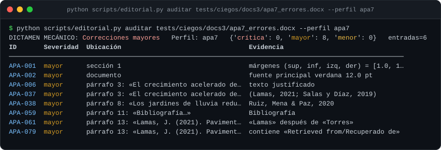
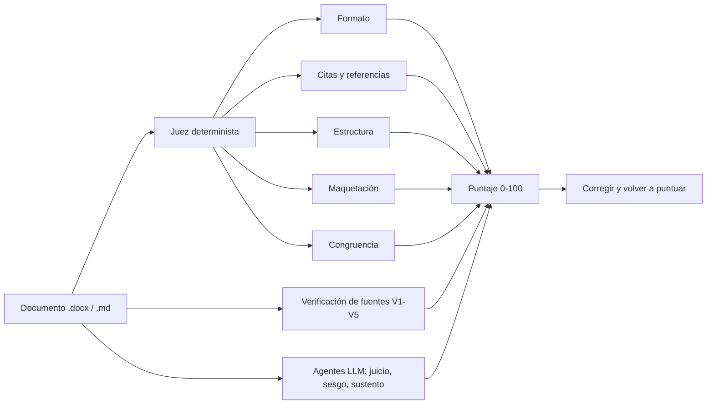
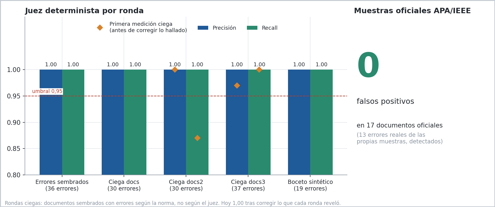
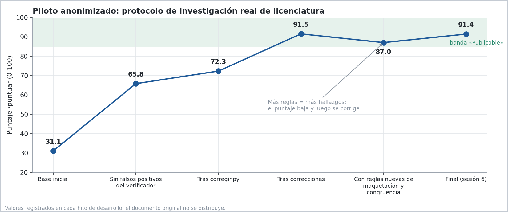

# editorial-academica

**Editor y juez académico para tesis, informes y artículos en APA 7 e IEEE: audita el formato de tu Word, verifica que las fuentes existan y digan lo que se les atribuye, y te da un puntaje de 0 a 100 con las correcciones que más lo suben.**

[](https://github.com/Xavier82h8/editorial-academica/actions/workflows/pruebas.yml)
[](LICENSE)
[](requirements.txt)
[](CHANGELOG.md)
[](docs/REGLAS.md)



## Por qué

- **Estudiantes**: llega a la entrega con el formato correcto y sabiendo qué corregir primero, sin releer 40 páginas contra el manual.
- **Investigadores**: cada hallazgo cita su regla (`APA-034`, `IEEE-093`) y la sección oficial; las fuentes se comprueban contra Crossref y OpenAlex, no contra la memoria de un modelo.
- **Docentes**: un criterio reproducible y explicable. El mismo documento da siempre el mismo puntaje; lo que requiere juicio queda marcado como juicio.
- **Comités editoriales**: dictamen uniforme (formato, citas, estructura, congruencia) con perfiles de equipo para las excepciones de la institución.

Funciona como plugin de Claude Code y, con el mismo núcleo, desde Gemini CLI, Codex, Cursor, Copilot CLI, OpenCode o la línea de comandos.

## Qué hace

Cada comando existe como `/editorial-academica:<nombre>` en Claude Code y como `python scripts/editorial.py <nombre>` en cualquier CLI.

| Comando | Para qué | Ejemplo |
|---|---|---|
| `auditar` | Dictamen de formato, citas y referencias, cada hallazgo con su ID de regla | `auditar tesis.docx --perfil apa7` |
| `corregir` | Arregla el formato mecánico en una copia `.corregido.docx` (nunca toca el original) | `corregir tesis.docx --perfil apa7 --paginacion encabezado` |
| `puntuar` | Puntaje 0-100, 5 correcciones de mayor impacto e historial | `puntuar tesis.docx --perfil apa7` |
| `congruencia` | Objetivos, método, resultados y conclusiones; cifras, siglas y referencias cruzadas | `congruencia tesis.docx` |
| `estructura` | Secciones que exige el género y maquetación (paginación, tablas, portada) | `estructura tesis.docx --estructura tesis --perfil apa7` |
| `fuentes` | Busca y verifica fuentes (V1-V5) y genera `fuentes.json` | `fuentes "evaluación con IA generativa" --n 15 --out fuentes.json` |
| `convertir` | Pasa un Word de APA a IEEE (o al revés) re-renderizando citas y referencias | `convertir tesis.docx --a ieee` |
| `render` | Markdown con `[@id]` a .docx, PDF, LaTeX o md con CSL | `render informe.md --perfil apa7 --fuentes fuentes.json --salida docx` |
| `informe`, `tesis` | Redacta con solo fuentes verificadas (skills y agentes de tu CLI) | `/editorial-academica:informe "tema" --perfil apa7` |

## Instalación

| CLI | Cómo |
|---|---|
| **Claude Code** | `/plugin marketplace add Xavier82h8/editorial-academica` y después `/plugin install editorial-academica@editorial-academica` |
| **Gemini CLI** | `gemini extensions install https://github.com/Xavier82h8/editorial-academica` |
| **Codex / Cursor / Copilot / OpenCode** | `python scripts/instalar.py --cli codex` (o `cursor`, `copilot`, `opencode`; `--proyecto DIR` para instalar solo en un proyecto) |
| **CLI pura** | `pip install -r requirements.txt` y `python scripts/editorial.py <subcomando> …` |

Requisitos: Python 3.10+, [pandoc](https://pandoc.org/installing.html) 3.x para `render` y `convertir` (`winget install --id JohnMacFarlane.Pandoc`, `brew install pandoc`, `apt install pandoc`) y xelatex (MiKTeX o TeX Live) solo para PDF y LaTeX. Las instrucciones para agentes están en [AGENTS.md](AGENTS.md).

## Inicio rápido

```bash
pip install -r requirements.txt
python scripts/editorial.py auditar mi_tesis.docx --perfil apa7      # qué está mal, con regla y sección oficial
python scripts/editorial.py corregir mi_tesis.docx --perfil apa7     # escribe mi_tesis.corregido.docx
python scripts/editorial.py puntuar mi_tesis.corregido.docx --perfil apa7
```


## Cómo juzga



Lo mecánico lo hacen scripts deterministas (mismo documento, mismo resultado). Los agentes aportan lo que requiere juicio (lenguaje sin sesgo, claridad, adecuación de una cita) y se marcan como tales. Todas las reglas, con severidad, quién las evalúa y su fuente, están en [docs/REGLAS.md](docs/REGLAS.md).


### Verificación de fuentes V1-V5
- **V1 existencia**: el DOI resuelve (Crossref o DataCite) o la URL responde.
- **V2 metadatos**: título, primer autor y año coinciden con el registro.
- **V3 integridad**: retractaciones y expresiones de preocupación; si citas un preprint, sugiere la versión publicada.
- **V4 calidad**: avisos (revista sin ISSN, preprint sin revisión) y DOI faltantes (APA 9.34).
- **V5 sustento**: compara cada oración citada con el resumen de su fuente y marca lo contradicho o lo que la fuente no dice.

Un fallo de red nunca cuenta como «verificado»: la fuente queda `no_verificado` con su motivo.

### Puntaje

| Dimensión | Peso |
|---|---:|
| Congruencia | 30 |
| Fuentes | 25 |
| Formato | 20 |
| Estructura | 15 |
| Redacción | 10 |

Bandas: **90 o más** Publicable, **75-89** Correcciones menores, **60-74** Correcciones mayores, **menos de 60** Rechazado. Una fuente que falle V1-V3 o una incongruencia crítica bloquea «Publicable» aunque la suma alcance. El historial entre versiones queda en `.editorial/puntajes.jsonl` junto al documento (`--sin-historial` lo desactiva).

## Resultados

Medidos con [`scripts/estadisticas.py`](scripts/estadisticas.py) (datos en [docs/estadisticas.json](docs/estadisticas.json)).

| Métrica | Resultado |
|---|---|
| Precisión / recall del juez, errores sembrados | 1,00 / 1,00 (36 errores) |
| Rondas ciegas (3 documentos nuevos, 97 errores) | 1,00 / 1,00 tras corregir lo que cada ronda reveló |
| Boceto sintético de estudiante | recall mecánico 1,00 (19/19), 0 falsos positivos |
| Falsos positivos en muestras oficiales APA/IEEE | **0 en 17 documentos** |
| Reglas | 323: 86 deterministas, 237 de agente, 30 corregibles automáticamente |
| Piloto: protocolo de investigación real de licenciatura (anonimizado) | 31,1 a 91,4 (Publicable) |
| Suite rápida | unos 90 s (Windows, Python 3.10, sin red) |



Las rondas ciegas se sembraron con errores según la norma y no según el juez; la primera medición de las rondas 2 y 3 fue menor (recall 0,87 y precisión 0,97) y se corrigió lo que revelaron. Los 1,00 actuales son una puerta de regresión, no una promesa sobre documentos nuevos.


Sobre el conteo de reglas, con honestidad: el catálogo llama «determinista» a toda regla cuyo ID aparece en algún script (56 de las 285 APA/IEEE). El checklist marca 115 como mecánicas («Fix: sí»), así que hay trabajo pendiente entre lo automatizable y lo implementado.



## Perfiles y `.editorial.yaml`

Perfiles: `apa7`, `apa7-profesional`, `ieee`, `apa7-base+ieee-citas`, `ieee-base+apa7-citas` (maquetación de una norma, citas de la otra).

Un `.editorial.yaml` en la carpeta del proyecto fija el perfil y el género por defecto y las excepciones de tu institución; el juez las informa como «excepción institucional», no como error.

```yaml
institucion: "Mi universidad"
perfil: apa7
estructura: tesis
portada_numero: no            # APA §2.18 pide número en la portada; muchas instituciones lo prohíben
excepciones:
  - regla: APA-001            # márgenes
    si_contiene: "1.5"        # solo el margen izquierdo de 1.5 in
    motivo: "La guía institucional pide 1.5 in para encuadernar"
```

Ejemplo completo en [perfiles/equipo-ejemplo.editorial.yaml](perfiles/equipo-ejemplo.editorial.yaml).

## Privacidad

Solo se envían a servicios externos (Crossref, OpenAlex, DataCite, doi.org) **DOI, títulos y URL de las obras**; nunca el texto de tu documento. La caché vive en tu directorio de usuario (`EDITORIAL_CACHE`, o `~/.cache/editorial-academica`), no en el proyecto. `--sin-red` desactiva toda consulta.

## Límites

- V5 solo verifica contra el resumen de la fuente; lo que esté solo en el texto completo queda «no verificable».
- `corregir` solo corrige perfiles de base APA; con base IEEE se audita pero sale con código 2.
- Las reglas de agente (lenguaje sin sesgo, claridad, adecuación de una cita) no son deterministas: dos corridas pueden diferir.
- Las normas oficiales (`normas/`) no se distribuyen; se obtienen con `python scripts/obtener_normas.py`. Sin ellas, las pruebas que las necesitan se saltan con aviso.
- El juez cubre el .docx y el Markdown; PDF y LaTeX los evalúa el agente tras extraer el texto.

## Hoja de ruta

- Corrector automático para perfiles de base IEEE.
- Encabezados de nivel 4 y 5 en línea.
- V5 con texto completo de fuentes de acceso abierto.
- Citas dentro de celdas de tabla (APA-034).
- Servidor MCP para usar el juez desde cualquier cliente.

## Contribuir

Lee [CONTRIBUTING.md](CONTRIBUTING.md): entorno, pruebas (`python tests/run_todo.py --rapido --sin-red`) y cómo añadir una regla con su caso sembrado. Los falsos positivos se reportan con la plantilla de Issues. Cambios por versión en [CHANGELOG.md](CHANGELOG.md).

## Licencia y avisos

Código bajo [licencia MIT](LICENSE). Las plantillas CSL son del proyecto Citation Style Language (CC BY-SA 3.0) y otros materiales de terceros se detallan en [NOTICE](NOTICE). APA® es marca de la American Psychological Association e IEEE® del Institute of Electrical and Electronics Engineers; este proyecto es independiente y no está afiliado a ellas.

## English summary

**editorial-academica** is an editor and judge for academic documents (theses, reports, articles) in **APA 7** or **IEEE** style, or a mix (layout from one, citations from the other). It runs as a Claude Code plugin and, through the same Python core, from Gemini CLI, Codex, Cursor, Copilot CLI, OpenCode or a plain command line (`python scripts/editorial.py <auditar|corregir|puntuar|...>`).

- **Deterministic judge**: format, citations, structure, layout and internal consistency, every finding tied to a rule ID and its official section; judgment-based rules are delegated to LLM agents and labelled as such.
- **Source verification V1-V5**: existence, metadata, retractions, quality and claim support against abstracts (Crossref, OpenAlex). Only DOIs, titles and URLs leave your machine, never the document text. Network failures are reported as `no_verificado`, never as verified.
- **Score 0-100**: consistency 30, sources 25, format 20, structure 15, writing 10, with the five highest-impact fixes. `corregir` fixes mechanical APA formatting on a copy.
- **Measured**: 0 false positives on 17 official APA/IEEE samples; precision and recall of 1.00 on the seeded and blind regression rounds; 323 rules (86 deterministic, 237 agent-based, 30 auto-fixable).
- **Honest limits**: V5 checks abstracts only, the auto-corrector targets APA-based profiles, agent rules are non-deterministic, and the official standards are not distributed (`python scripts/obtener_normas.py`).

Install: `/plugin marketplace add Xavier82h8/editorial-academica` (Claude Code), `gemini extensions install https://github.com/Xavier82h8/editorial-academica` (Gemini CLI), or `pip install -r requirements.txt` for the CLI. MIT licensed; see [NOTICE](NOTICE) for third-party material. APA® and IEEE® are trademarks of their owners; this project is not affiliated with them.
