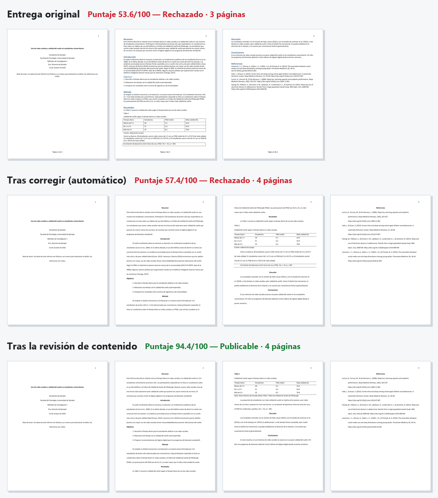
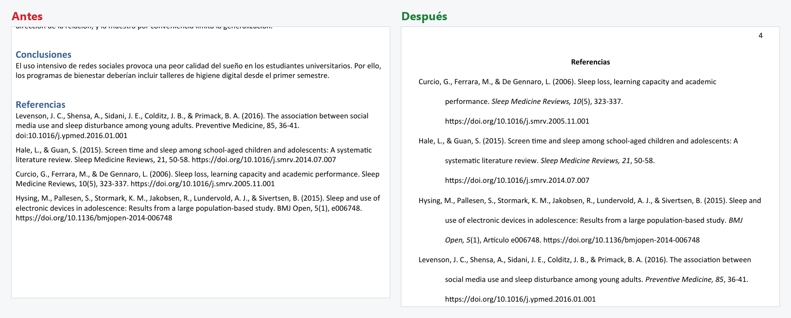

# Ejemplo completo: de 53.6 a 94.4

Un informe de estudiante de tres páginas, con los errores que más se repiten en una entrega real, recorrido de principio a fin con el editor. Todo lo que ves aquí sale de ejecutar los comandos; los números se pueden reproducir.

- **Los datos del estudio son ficticios** (lo dice la nota de autor de la portada).
- **Las cuatro referencias son reales** y se verificaron contra Crossref con el propio editor (`fuentes.json`).
- Las páginas se renderizaron con LibreOffice 26.8, no son maquetas.



## Cómo reproducirlo

```bash
python ejemplos/crear_ejemplo.py                                        # 1. la entrega con errores
python scripts/editorial.py auditar ejemplos/informe-ejemplo.docx --perfil apa7
python scripts/editorial.py corregir ejemplos/informe-ejemplo.docx --perfil apa7 \
       --paginacion encabezado --portada-numero si                      # 2. corrección automática (copia)
python ejemplos/revisar_contenido.py ejemplos/informe-ejemplo.corregido.docx \
       ejemplos/informe-ejemplo.final.docx                              # 3. revisión de contenido
python scripts/editorial.py puntuar ejemplos/informe-ejemplo.final.docx --perfil apa7 --estructura informe \
       --fuentes ejemplos/fuentes.json --evidencias ejemplos/evidencias.json
python ejemplos/capturas.py                                             # imágenes (requiere LibreOffice)
```

## 1. La entrega original: 53.6, Rechazado

`auditar` encuentra **24 hallazgos** (3 críticos, 16 mayores, 5 menores); `estructura` y `congruencia` suman los de maquetación y coherencia interna:

| Qué se sembró | Lo que dice el editor |
|---|---|
| Cita a Twenge (2017) sin entrada en la lista; Hysing et al. (2015) en la lista pero nunca citado | `APA-034` crítica, dos veces |
| `[[FALTA FUENTE: dato de la OMS]]` olvidado en el texto | `EA-001` crítica |
| El resumen dice 120 participantes; el método, 112 | `CON-001` crítica |
| «El uso intensivo de redes sociales **provoca**…» con un diseño transversal | `CON-007` mayor: usar lenguaje de asociación |
| Objetivo 3 (comparar por carrera) que nunca vuelve a aparecer | `CON-020` mayor |
| «Como se observa, 28 estudiantes… 4.1… 25.0 %…»: el párrafo repite la tabla | `CON-008` menor |
| «Levenson & Shensa (2016)»: obra de cinco autores, con «&» en cita narrativa | `APA-037` y `APA-038` |
| Número de página arriba **y** «Página X de Y» abajo | `EST-010` mayor, `EST-011` menor |
| Nota de tabla «Fuente: elaboración propia» | `EST-015` y `APA-094` |
| Márgenes de 0.75 in, interlineado sencillo, sin sangría, encabezados azules de 14 pt | `APA-001`, `APA-004`, `APA-007`, `APA-025`, `APA-003` |
| Lista sin orden alfabético, sin sangría francesa, `doi:10.…` y revistas sin cursiva | `APA-061`, `APA-060`, `APA-076`, `APA-072` |

## 2. `corregir`: 28 hallazgos → 9, puntaje 57.4

La copia `informe-ejemplo.corregido.docx` (el original no se toca) arregla todo lo mecánico: márgenes, interlineado, sangrías, encabezados APA en negro y del tamaño del texto, una sola numeración de página, tabla que no se parte, bordes de tabla APA, lista ordenada con sangría francesa, `https://doi.org/` y la conjunción de las citas.

El puntaje apenas sube porque **lo que bloquea no es el formato**: siguen la cita sin referencia, el marcador olvidado y el tamaño de muestra contradictorio. `corregir` los deja listados como «no automático», porque arreglarlos exige decidir contenido.

## 3. Revisión de contenido: 94.4, Publicable

[`revisar_contenido.py`](revisar_contenido.py) aplica lo que haría el agente (o tú) siguiendo cada hallazgo; cada edición cita el ID que la motiva y ninguna inventa datos ni fuentes:

- se quitan la afirmación sin fuente (OMS) y la cita a Twenge, que no estaba verificada;
- el resumen pasa a 112 participantes, como el método;
- «provoca» pasa a «se asoció con», y el objetivo 3 se sustituye por el que sí atienden las conclusiones;
- el párrafo que repetía la tabla ahora dice qué debe ver el lector; la tabla de una celda pasa al texto;
- se cita a Hysing et al. (2015) en la discusión, con lo que su resumen respalda;
- la nota de la tabla empieza con *Nota.*, y revista y volumen van en cursiva.




## Por qué no llega a 100

La dimensión **Fuentes** queda en 19.4 de 25, y es lo correcto: de las cuatro obras, solo Hysing et al. (2015) publica su resumen en Crossref u OpenAlex. Las otras tres (Elsevier) no lo hacen, así que el sustento de tres de las cuatro afirmaciones citadas queda **«no verificable»** ([`evidencias.json`](evidencias.json)) y cuenta la mitad. El editor no da por buena una afirmación que no pudo comprobar.
