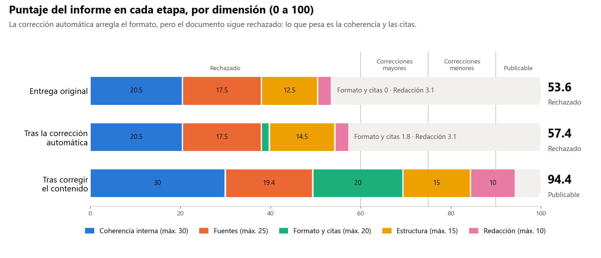
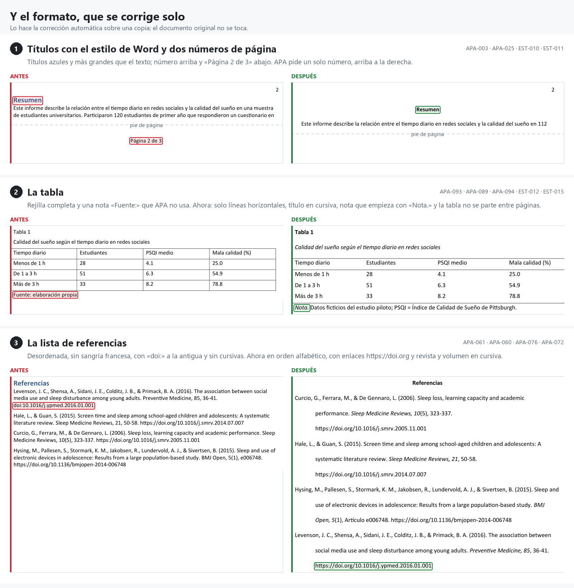
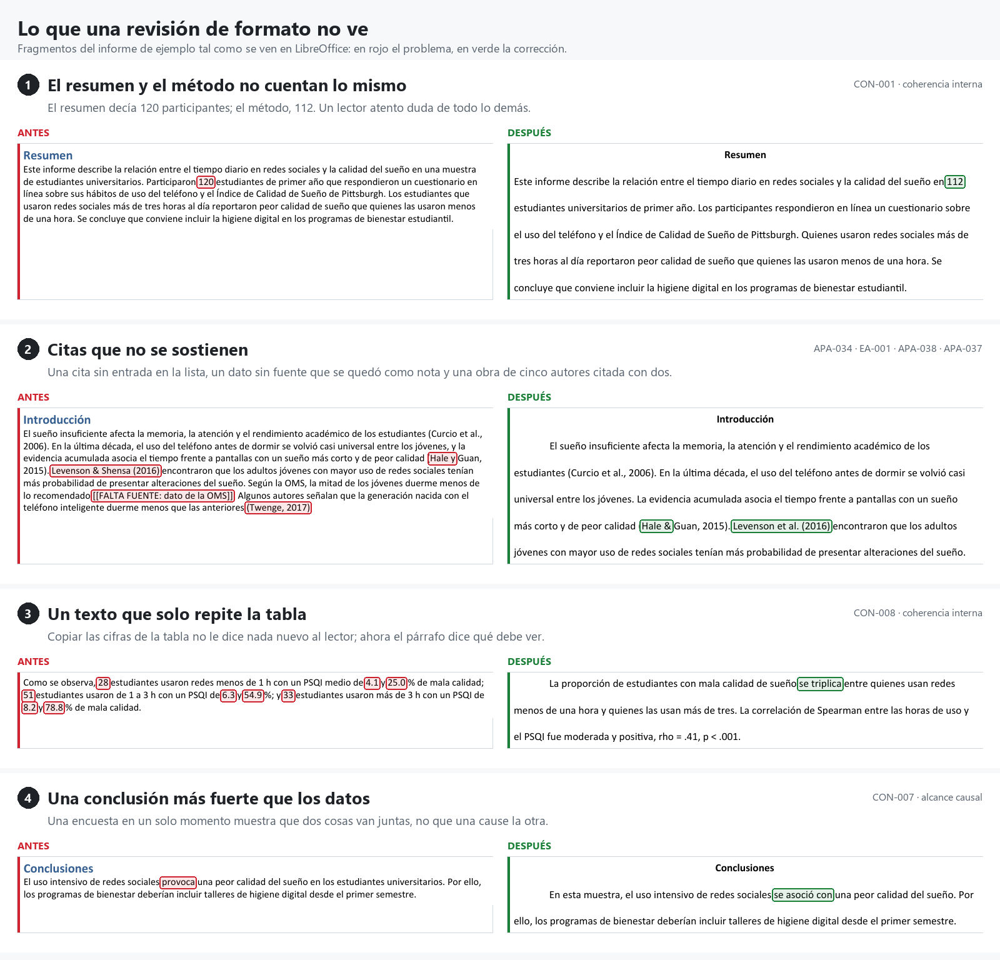

# Ejemplo completo: de 53.6 a 94.4

Un informe de estudiante de tres páginas, con los errores que más se repiten en una entrega real, recorrido de principio a fin con el editor. Todo lo que ves aquí sale de ejecutar los comandos; los números se pueden reproducir y una prueba automática comprueba en cada cambio que siguen siendo estos.

- **Los datos del estudio son ficticios** (lo dice la nota de autor de la portada).
- **Las cuatro referencias son reales** y se verificaron contra Crossref con el propio editor ([`fuentes.json`](fuentes.json)).
- Las imágenes son fragmentos del documento abierto con LibreOffice 26.8, no maquetas.



## Los archivos

| Archivo | Qué es |
|---|---|
| [`informe-ejemplo.docx`](informe-ejemplo.docx) | La entrega original, con los errores |
| [`informe-ejemplo.corregido.docx`](informe-ejemplo.corregido.docx) | La copia que deja la corrección automática |
| [`informe-ejemplo.final.docx`](informe-ejemplo.final.docx) | La versión con el contenido corregido |
| [`fuentes.json`](fuentes.json) | Las cuatro referencias, con los metadatos que devolvió Crossref |
| [`evidencias.json`](evidencias.json) | Qué afirmación respalda cada fuente según su resumen, y cuáles no se pueden comprobar |
| [`crear_ejemplo.py`](crear_ejemplo.py) | Genera la entrega original desde cero, con cada error sembrado a propósito y documentado |
| [`revisar_contenido.py`](revisar_contenido.py) | Aplica las correcciones de contenido del paso 3, cada una con el código de regla que la motiva |
| [`capturas.py`](capturas.py) | Abre los tres documentos con LibreOffice, recorta las zonas que cambiaron y dibuja las imágenes de esta página |

## 1. La entrega original: 53.6, Rechazado

El revisor encuentra **24 problemas de formato y citas** (3 críticos, 16 mayores, 5 menores), **4 de coherencia** y **4 de maquetación**:

| Qué se sembró | Lo que dice el editor |
|---|---|
| Cita a Twenge (2017) sin entrada en la lista; Hysing et al. (2015) en la lista pero nunca citado | `APA-034`, crítica, dos veces |
| `[[FALTA FUENTE: dato de la OMS]]` olvidado en el texto | `EA-001`, crítica |
| El resumen dice 120 participantes; el método, 112 | `CON-001`, crítica |
| «El uso intensivo de redes sociales **provoca**…» con un diseño transversal | `CON-007`: usar lenguaje de asociación |
| Objetivo 3 (comparar por carrera) que nunca vuelve a aparecer | `CON-020` |
| «Como se observa, 28 estudiantes… 4.1… 25.0 %…»: el párrafo repite la tabla | `CON-008` |
| «Levenson & Shensa (2016)»: obra de cinco autores, con «&» en cita narrativa | `APA-037` y `APA-038` |
| Número de página arriba **y** «Página X de Y» abajo | `EST-010` y `EST-011` |
| Nota de tabla «Fuente: elaboración propia» | `EST-015` y `APA-094` |
| Márgenes de 0.75 in, interlineado sencillo, sin sangría, títulos azules de 14 pt | `APA-001`, `APA-004`, `APA-007`, `APA-025`, `APA-003` |
| Lista sin orden alfabético, sin sangría francesa, `doi:10.…` y revistas sin cursiva | `APA-061`, `APA-060`, `APA-076`, `APA-072` |

## 2. Corrección automática: 28 problemas → 9, puntaje 57.4

La corrección automática escribe una copia (`informe-ejemplo.corregido.docx`) y deja el original intacto. Arregla todo lo mecánico: márgenes, interlineado, sangrías, títulos en el formato APA (negro, del tamaño del texto), una sola numeración de página, tabla que no se parte, bordes de tabla APA, lista ordenada con sangría francesa, enlaces `https://doi.org/` y la conjunción de las citas.

El puntaje apenas sube porque **lo que bloquea no es el formato**: siguen la cita sin referencia, el marcador olvidado y el tamaño de muestra contradictorio. Arreglar eso exige decidir contenido, así que el corrector no lo toca: lo deja listado como «no automático».



## 3. Corrección del contenido: 94.4, Publicable

Es lo que haría tu agente (o tú) siguiendo cada hallazgo; aquí lo aplica un guion para que se pueda repetir. Ninguna edición inventa datos ni fuentes:

- se quitan la afirmación sin fuente (OMS) y la cita a Twenge, que no estaba verificada;
- el resumen pasa a 112 participantes, como el método;
- «provoca» pasa a «se asoció con», y el objetivo 3 se sustituye por el que sí atienden las conclusiones;
- el párrafo que repetía la tabla ahora dice qué debe ver el lector, y la tabla de una sola celda pasa al texto;
- se cita a Hysing et al. (2015) en la discusión, con lo que su resumen respalda;
- la nota de la tabla empieza con *Nota.*, y revista y volumen van en cursiva.



## Por qué no llega a 100

La dimensión **Fuentes** queda en 19.4 de 25, y es lo correcto: de las cuatro obras, solo Hysing et al. (2015) publica su resumen en Crossref u OpenAlex. Las otras tres (Elsevier) no lo hacen, así que el sustento de tres de las cuatro afirmaciones citadas queda **«no verificable»** ([`evidencias.json`](evidencias.json)) y cuenta la mitad. El editor no da por buena una afirmación que no pudo comprobar.

## Cómo reproducirlo

Desde la raíz del repositorio:

```bash
python ejemplos/crear_ejemplo.py                                     # 1. genera la entrega con errores
python scripts/editorial.py auditar ejemplos/informe-ejemplo.docx --perfil apa7          # lista los problemas
python scripts/editorial.py corregir ejemplos/informe-ejemplo.docx --perfil apa7 \
       --paginacion encabezado --portada-numero si                   # 2. corrección automática, en una copia
python ejemplos/revisar_contenido.py ejemplos/informe-ejemplo.corregido.docx \
       ejemplos/informe-ejemplo.final.docx                           # 3. correcciones de contenido
python scripts/editorial.py puntuar ejemplos/informe-ejemplo.final.docx --perfil apa7 --estructura informe \
       --fuentes ejemplos/fuentes.json --evidencias ejemplos/evidencias.json                # puntaje final
python ejemplos/capturas.py                                          # imágenes (LibreOffice + requirements-dev.txt)
```
